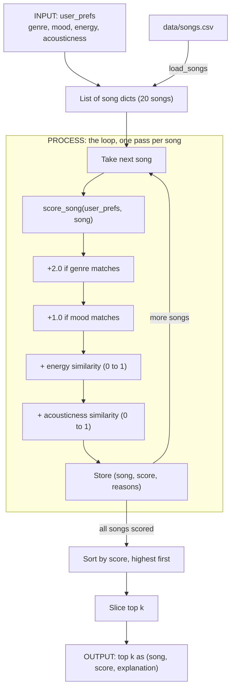

# 🎵 Music Recommender Simulation

## Project Summary

In this project you will build and explain a small music recommender system.

Your goal is to:

- Represent songs and a user "taste profile" as data
- Design a scoring rule that turns that data into recommendations
- Evaluate what your system gets right and wrong
- Reflect on how this mirrors real world AI recommenders

Replace this paragraph with your own summary of what your version does.

---

## How The System Works

The recommender compares one listener's taste profile against every song in the
catalog, scores each song for how well it fits, and returns the best matches.

- **Song features:** `genre`, `mood`, `energy`, `acousticness` are used for scoring.
  `tempo_bpm`, `valence` and `danceability` are loaded but not scored yet (tempo
  mostly repeats energy and isn't on a 0-1 scale).
- **User profile:** a favorite `genre`, a favorite `mood`, a target `energy`, and a
  target `acousticness` (0.0 to 1.0). Example: lofi, chill, 0.40, 0.75.
- **Scoring:** each song earns points from the rules in the Algorithm Recipe below.
- **Choosing recommendations:** sort all songs by score and return the top `k`.

### Algorithm Recipe

Each song gets a score from 0.0 to 5.0 against the user's taste profile
(`genre`, `mood`, `energy`, `acousticness`):

| Rule | Points |
|---|---|
| Genre matches exactly | +2.0 |
| Mood matches exactly | +1.0 |
| Energy similarity: `1.0 * (1 - abs(song.energy - target_energy))` | 0.0 to 1.0 |
| Acousticness similarity: `1.0 * (1 - abs(song.acousticness - target_acousticness))` | 0.0 to 1.0 |

Songs are scored one at a time, sorted by score (highest first), and the top `k`
are returned. Each result carries the reasons that earned points (for example
"genre match (+2.0)", "energy close to target (+0.97)").

Why these weights:

- **Genre (2.0) outweighs mood (1.0).** Genre is the stronger signal of taste, and
  with 20 songs a genre match is rare enough to deserve the biggest bonus.
  Dropping it to 1.0 let a wrong-genre song (Spacewalk Thoughts) climb into the top
  3 for a lofi listener.
- **Energy and acousticness are continuous.** A numeric difference gives partial
  credit, so near misses rank above far misses instead of everything non-matching
  scoring zero. Together they can contribute up to 2.0, the same as a genre match.
- **Energy is not weighted above 1.0.** In testing, raising it to 1.5 and halving
  acousticness changed no top-3 results, so the extra complexity wasn't worth it.

### Expected Biases

- **Genre is over-prioritized.** A genre match is worth 2.0 of 5.0 points, so a song
  in the right genre but the wrong feel can beat a great mood and energy match in
  another genre. Test case: for a pop + intense + low-energy profile, `Gym Hero`
  (energy 0.93) still ranks first.
- **Exact-match labels ignore similarity.** `indie pop` earns nothing for a `pop`
  fan, and `relaxed` earns nothing for a `chill` listener, though they are close.
- **One song per genre for most genres.** 15 of the 17 genres appear once in the
  catalog, so a genre match often means one song, and genre-heavy scoring pushes it
  to the top whatever its other features.
- **Single-taste profiles.** The profile holds one genre and one mood, so listeners
  with mixed tastes are modeled poorly.
- **Unscored features.** `valence`, `danceability` and `tempo_bpm` are ignored, so
  songs that differ on them (such as `metal` and `edm`) can score alike.
- **Small, hand-written catalog.** The 20 songs and their feature values reflect my
  own judgment of each genre, which bakes in stereotypes (all `metal` is low
  valence, all `classical` is low energy).

### Data Flow



Function mapping (`src/recommender.py`):

| Step | Function |
|---|---|
| Read CSV into song dicts | `load_songs` |
| Judge one song, return `(score, reasons)` | `score_song` |
| Run the loop, sort, slice top `k`, build explanations | `recommend_songs` |

---

## Getting Started

### Setup

1. Create a virtual environment (optional but recommended):

   ```bash
   python -m venv .venv
   source .venv/bin/activate      # Mac or Linux
   .venv\Scripts\activate         # Windows

2. Install dependencies

```bash
pip install -r requirements.txt
```

3. Run the app:

```bash
python -m src.main
```

### Running Tests

Run the starter tests with:

```bash
pytest
```

You can add more tests in `tests/test_recommender.py`.

---

## Sample Recommendation Output

Output of `python -m src.main` (run from the project root), top 5 for each of the three standard profiles:

#### High-Energy Pop

```
================================================================
Profile: High-Energy Pop
  (genre=pop, mood=happy, energy=0.9, acousticness=0.1)
================================================================
1. Sunrise City by Neon Echo
   Score: 4.84
   Why:
     - genre match (+2.0)
     - mood match (+1.0)
     - energy close to target (+0.92)
     - acousticness close to target (+0.92)

2. Gym Hero by Max Pulse
   Score: 3.92
   Why:
     - genre match (+2.0)
     - energy close to target (+0.97)
     - acousticness close to target (+0.95)

3. Rooftop Lights by Indigo Parade
   Score: 2.61
   Why:
     - mood match (+1.0)
     - energy close to target (+0.86)
     - acousticness close to target (+0.75)

4. Storm Runner by Voltline
   Score: 1.99
   Why:
     - energy close to target (+0.99)
     - acousticness close to target (+1.00)

5. Fuego en la Calle by Luna Brava
   Score: 1.91
   Why:
     - energy close to target (+0.96)
     - acousticness close to target (+0.95)
```

#### Chill Lofi

```
================================================================
Profile: Chill Lofi
  (genre=lofi, mood=chill, energy=0.4, acousticness=0.75)
================================================================
1. Midnight Coding by LoRoom
   Score: 4.94
   Why:
     - genre match (+2.0)
     - mood match (+1.0)
     - energy close to target (+0.98)
     - acousticness close to target (+0.96)

2. Library Rain by Paper Lanterns
   Score: 4.84
   Why:
     - genre match (+2.0)
     - mood match (+1.0)
     - energy close to target (+0.95)
     - acousticness close to target (+0.89)

3. Focus Flow by LoRoom
   Score: 3.97
   Why:
     - genre match (+2.0)
     - energy close to target (+1.00)
     - acousticness close to target (+0.97)

4. Spacewalk Thoughts by Orbit Bloom
   Score: 2.71
   Why:
     - mood match (+1.0)
     - energy close to target (+0.88)
     - acousticness close to target (+0.83)

5. Porch Light Blues by Delta Hollow
   Score: 1.92
   Why:
     - energy close to target (+1.00)
     - acousticness close to target (+0.92)
```

#### Deep Intense Rock

```
================================================================
Profile: Deep Intense Rock
  (genre=rock, mood=intense, energy=0.92, acousticness=0.1)
================================================================
1. Storm Runner by Voltline
   Score: 4.99
   Why:
     - genre match (+2.0)
     - mood match (+1.0)
     - energy close to target (+0.99)
     - acousticness close to target (+1.00)

2. Gym Hero by Max Pulse
   Score: 2.94
   Why:
     - mood match (+1.0)
     - energy close to target (+0.99)
     - acousticness close to target (+0.95)

3. Warehouse 4AM by Pulse Theory
   Score: 1.91
   Why:
     - energy close to target (+0.98)
     - acousticness close to target (+0.93)

4. Iron Cathedral by Black Meridian
   Score: 1.89
   Why:
     - energy close to target (+0.95)
     - acousticness close to target (+0.94)

5. Fuego en la Calle by Luna Brava
   Score: 1.89
   Why:
     - energy close to target (+0.94)
     - acousticness close to target (+0.95)
```

**Screenshot or video** *(optional)*: <!-- Insert a screenshot or demo video link here -->

---

## Experiments You Tried

### Adversarial and edge-case profiles

These profiles were designed to trick the scoring logic. Each shows the top 5 from `python -m src.main`.

#### Conflict: High Energy + Sad

```
================================================================
Profile: Conflict: High Energy + Sad
  (genre=blues, mood=sad, energy=0.9)
================================================================
1. Porch Light Blues by Delta Hollow
   Score: 2.50
   Why:
     - genre match (+2.0)
     - energy close to target (+0.50)

2. Storm Runner by Voltline
   Score: 0.99
   Why:
     - energy close to target (+0.99)

3. Gym Hero by Max Pulse
   Score: 0.97
   Why:
     - energy close to target (+0.97)

4. Warehouse 4AM by Pulse Theory
   Score: 0.96
   Why:
     - energy close to target (+0.96)

5. Fuego en la Calle by Luna Brava
   Score: 0.96
   Why:
     - energy close to target (+0.96)
```

**What happened:** `sad` is not a mood label in the catalog (it has `sorrowful` and `melancholy`), so the mood rule silently scored 0 for every song. The only blues song wins on genre alone (2.50) even though its energy (0.40) is far from 0.9, and results 2-5 are all upbeat songs. The "sad" half of the request is ignored without any warning.

#### Conflict: Metal + Chill + Quiet

```
================================================================
Profile: Conflict: Metal + Chill + Quiet
  (genre=metal, mood=chill, energy=0.2, acousticness=0.9)
================================================================
1. Spacewalk Thoughts by Orbit Bloom
   Score: 2.90
   Why:
     - mood match (+1.0)
     - energy close to target (+0.92)
     - acousticness close to target (+0.98)

2. Library Rain by Paper Lanterns
   Score: 2.81
   Why:
     - mood match (+1.0)
     - energy close to target (+0.85)
     - acousticness close to target (+0.96)

3. Midnight Coding by LoRoom
   Score: 2.59
   Why:
     - mood match (+1.0)
     - energy close to target (+0.78)
     - acousticness close to target (+0.81)

4. Iron Cathedral by Black Meridian
   Score: 2.37
   Why:
     - genre match (+2.0)
     - energy close to target (+0.23)
     - acousticness close to target (+0.14)

5. Clockwork Sonata by Elise Varga
   Score: 1.91
   Why:
     - energy close to target (+0.98)
     - acousticness close to target (+0.93)
```

**What happened:** the three chill, quiet songs (Spacewalk Thoughts, Library Rain, Midnight Coding) beat the metal song, so the system was not fully tricked. But Iron Cathedral (energy 0.97, acousticness 0.04, the opposite of the request) still reaches #4 at 2.37, above Clockwork Sonata (1.91), which matches the energy and acousticness almost exactly. The 2.0 genre bonus outweighs a complete mismatch on the numbers.

#### Unknown Genre (k-pop / happy)

```
================================================================
Profile: Unknown Genre (k-pop / happy)
  (genre=k-pop, mood=happy, energy=0.8)
================================================================
1. Sunrise City by Neon Echo
   Score: 1.98
   Why:
     - mood match (+1.0)
     - energy close to target (+0.98)

2. Rooftop Lights by Indigo Parade
   Score: 1.96
   Why:
     - mood match (+1.0)
     - energy close to target (+0.96)

3. Concrete Crown by Verse Valley
   Score: 0.98
   Why:
     - energy close to target (+0.98)

4. Night Drive Loop by Neon Echo
   Score: 0.95
   Why:
     - energy close to target (+0.95)

5. Fuego en la Calle by Luna Brava
   Score: 0.94
   Why:
     - energy close to target (+0.94)
```

**What happened:** this degrades gracefully. With no genre match possible, mood and energy decide, and the top two (Sunrise City, Rooftop Lights) are sensible. The scores are low (under 2.0), but nothing tells the user their genre was not found.

#### Extreme: Energy 1.0 + Acoustic 1.0

```
================================================================
Profile: Extreme: Energy 1.0 + Acoustic 1.0
  (energy=1.0, acousticness=1.0)
================================================================
1. Dust Road Hymn by Willow & Pine
   Score: 1.29
   Why:
     - energy close to target (+0.48)
     - acousticness close to target (+0.81)

2. Wildflower Static by Fern Atlas
   Score: 1.26
   Why:
     - energy close to target (+0.33)
     - acousticness close to target (+0.93)

3. Coffee Shop Stories by Slow Stereo
   Score: 1.26
   Why:
     - energy close to target (+0.37)
     - acousticness close to target (+0.89)

4. Porch Light Blues by Delta Hollow
   Score: 1.23
   Why:
     - energy close to target (+0.40)
     - acousticness close to target (+0.83)

5. Library Rain by Paper Lanterns
   Score: 1.21
   Why:
     - energy close to target (+0.35)
     - acousticness close to target (+0.86)
```

**What happened:** no song is both loud and acoustic, so the best score is only 1.29 and the top 5 are quiet acoustic songs (folk, country, jazz, blues, lofi). The system still returns a confident-looking ranking for a request nothing in the catalog can satisfy. Acousticness won out because its gaps (0.07-0.19) were smaller than the energy gaps.

### Weight shift: genre 2.0 → 1.0, energy 1.0 → 2.0

The maximum score stays 5.0 (1 + 1 + 2 + 1), so scores remain comparable. Across the
7 profiles, 6 kept the same #1 song and 5 kept the same top-5 order. Scores for ranks
2-5 rose because energy now contributes up to 2.0 and many songs are close in energy.

- **Fixed:** Metal + Chill + Quiet. Iron Cathedral (genre match but energy 0.97 against a
  target of 0.2) fell out of the top 5, replaced by Wildflower Static.
- **Weakened:** Conflict: High Energy + Sad. Porch Light Blues (2.00) barely leads
  Storm Runner (1.98), so the blues genre match no longer carries the list. That is
  arguably more balanced, but the "sad" request is still ignored.
- **Just different:** Extreme: Energy 1.0 + Acoustic 1.0 flipped from quiet acoustic songs
  to loud ones (Iron Cathedral first), because energy now outweighs acousticness.
  Neither list satisfies a request nothing in the catalog can meet.
- **Unchanged:** the Deep Intense Rock top 5 has the same order, and the rock song's
  lead over Gym Hero shrank from 2.05 to 1.05 points.

**Verdict:** more different than more accurate. It helped one adversarial case and
shrank the margin for genre-matched songs. I reverted to the original weights (genre 2.0,
energy 1.0).

### What the standard profiles showed

- Each profile's top result is a song that matches on every rule (Sunrise City 4.84, Midnight Coding 4.94, Storm Runner 4.99).
- Deep Intense Rock has only one rock song, so ranks 2-5 are pop, EDM, metal and latin songs chosen by energy and acousticness alone. Iron Cathedral (metal, angry) is arguably the closest fit but ranks 4th because `angry` is not `intense`.

---

## Limitations and Risks

Summarize some limitations of your recommender.

Examples:

- It only works on a tiny catalog
- It does not understand lyrics or language
- It might over favor one genre or mood

You will go deeper on this in your model card.

---

## Reflection

Read and complete `model_card.md`:

[**Model Card**](model_card.md)

Write 1 to 2 paragraphs here about what you learned:

- about how recommenders turn data into predictions
- about where bias or unfairness could show up in systems like this


