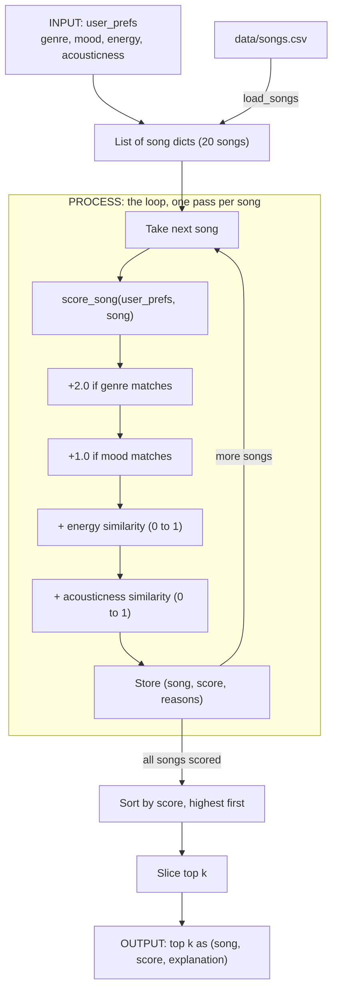

# 🎵 Music Recommender Simulation

## Project Summary

In this project you will build and explain a small music recommender system.

Your goal is to:

- Represent songs and a user "taste profile" as data
- Design a scoring rule that turns that data into recommendations
- Evaluate what your system gets right and wrong
- Reflect on how this mirrors real world AI recommenders

Replace this paragraph with your own summary of what your version does.

---

## How The System Works

The recommender compares one listener's taste profile against every song in the
catalog, scores each song for how well it fits, and returns the best matches.

- **Song features:** `genre`, `mood`, `energy`, `acousticness` are used for scoring.
  `tempo_bpm`, `valence` and `danceability` are loaded but not scored yet (tempo
  mostly repeats energy and isn't on a 0-1 scale).
- **User profile:** a favorite `genre`, a favorite `mood`, a target `energy`, and a
  target `acousticness` (0.0 to 1.0). Example: lofi, chill, 0.40, 0.75.
- **Scoring:** each song earns points from the rules in the Algorithm Recipe below.
- **Choosing recommendations:** sort all songs by score and return the top `k`.

### Algorithm Recipe

Each song gets a score from 0.0 to 5.0 against the user's taste profile
(`genre`, `mood`, `energy`, `acousticness`):

| Rule | Points |
|---|---|
| Genre matches exactly | +2.0 |
| Mood matches exactly | +1.0 |
| Energy similarity: `1.0 * (1 - abs(song.energy - target_energy))` | 0.0 to 1.0 |
| Acousticness similarity: `1.0 * (1 - abs(song.acousticness - target_acousticness))` | 0.0 to 1.0 |

Songs are scored one at a time, sorted by score (highest first), and the top `k`
are returned. Each result carries the reasons that earned points (for example
"genre match (+2.0)", "energy close to target (+0.97)").

Why these weights:

- **Genre (2.0) outweighs mood (1.0).** Genre is the stronger signal of taste, and
  with 20 songs a genre match is rare enough to deserve the biggest bonus.
  Dropping it to 1.0 let a wrong-genre song (Spacewalk Thoughts) climb into the top
  3 for a lofi listener.
- **Energy and acousticness are continuous.** A numeric difference gives partial
  credit, so near misses rank above far misses instead of everything non-matching
  scoring zero. Together they can contribute up to 2.0, the same as a genre match.
- **Energy is not weighted above 1.0.** In testing, raising it to 1.5 and halving
  acousticness changed no top-3 results, so the extra complexity wasn't worth it.

### Expected Biases

- **Genre is over-prioritized.** A genre match is worth 2.0 of 5.0 points, so a song
  in the right genre but the wrong feel can beat a great mood and energy match in
  another genre. Test case: for a pop + intense + low-energy profile, `Gym Hero`
  (energy 0.93) still ranks first.
- **Exact-match labels ignore similarity.** `indie pop` earns nothing for a `pop`
  fan, and `relaxed` earns nothing for a `chill` listener, though they are close.
- **One song per genre for most genres.** 15 of the 17 genres appear once in the
  catalog, so a genre match often means one song, and genre-heavy scoring pushes it
  to the top whatever its other features.
- **Single-taste profiles.** The profile holds one genre and one mood, so listeners
  with mixed tastes are modeled poorly.
- **Unscored features.** `valence`, `danceability` and `tempo_bpm` are ignored, so
  songs that differ on them (such as `metal` and `edm`) can score alike.
- **Small, hand-written catalog.** The 20 songs and their feature values reflect my
  own judgment of each genre, which bakes in stereotypes (all `metal` is low
  valence, all `classical` is low energy).

### Data Flow



Function mapping (`src/recommender.py`):

| Step | Function |
|---|---|
| Read CSV into song dicts | `load_songs` |
| Judge one song, return `(score, reasons)` | `score_song` |
| Run the loop, sort, slice top `k`, build explanations | `recommend_songs` |

---

## Getting Started

### Setup

1. Create a virtual environment (optional but recommended):

   ```bash
   python -m venv .venv
   source .venv/bin/activate      # Mac or Linux
   .venv\Scripts\activate         # Windows

2. Install dependencies

```bash
pip install -r requirements.txt
```

3. Run the app:

```bash
python -m src.main
```

### Running Tests

Run the starter tests with:

```bash
pytest
```

You can add more tests in `tests/test_recommender.py`.

---

## Sample Recommendation Output

Output of `python -m src.main` (run from the project root):

```
Loaded songs: 20

================================================================
Profile: Pop / Happy (starter profile)
  (genre=pop, mood=happy, energy=0.8)
================================================================
1. Sunrise City by Neon Echo
   Score: 3.98
   Why:
     - genre match (+2.0)
     - mood match (+1.0)
     - energy close to target (+0.98)

2. Gym Hero by Max Pulse
   Score: 2.87
   Why:
     - genre match (+2.0)
     - energy close to target (+0.87)

3. Rooftop Lights by Indigo Parade
   Score: 1.96
   Why:
     - mood match (+1.0)
     - energy close to target (+0.96)

4. Concrete Crown by Verse Valley
   Score: 0.98
   Why:
     - energy close to target (+0.98)

5. Night Drive Loop by Neon Echo
   Score: 0.95
   Why:
     - energy close to target (+0.95)

================================================================
Profile: Chill Lofi
  (genre=lofi, mood=chill, energy=0.4, acousticness=0.75)
================================================================
1. Midnight Coding by LoRoom
   Score: 4.94
   Why:
     - genre match (+2.0)
     - mood match (+1.0)
     - energy close to target (+0.98)
     - acousticness close to target (+0.96)

2. Library Rain by Paper Lanterns
   Score: 4.84
   Why:
     - genre match (+2.0)
     - mood match (+1.0)
     - energy close to target (+0.95)
     - acousticness close to target (+0.89)

3. Focus Flow by LoRoom
   Score: 3.97
   Why:
     - genre match (+2.0)
     - energy close to target (+1.00)
     - acousticness close to target (+0.97)

4. Spacewalk Thoughts by Orbit Bloom
   Score: 2.71
   Why:
     - mood match (+1.0)
     - energy close to target (+0.88)
     - acousticness close to target (+0.83)

5. Porch Light Blues by Delta Hollow
   Score: 1.92
   Why:
     - energy close to target (+1.00)
     - acousticness close to target (+0.92)
```

**Screenshot or video** *(optional)*: <!-- Insert a screenshot or demo video link here -->

---

## Experiments You Tried

Use this section to document the experiments you ran. For example:

- What happened when you changed the weight on genre from 2.0 to 0.5
- What happened when you added tempo or valence to the score
- How did your system behave for different types of users

---

## Limitations and Risks

Summarize some limitations of your recommender.

Examples:

- It only works on a tiny catalog
- It does not understand lyrics or language
- It might over favor one genre or mood

You will go deeper on this in your model card.

---

## Reflection

Read and complete `model_card.md`:

[**Model Card**](model_card.md)

Write 1 to 2 paragraphs here about what you learned:

- about how recommenders turn data into predictions
- about where bias or unfairness could show up in systems like this


