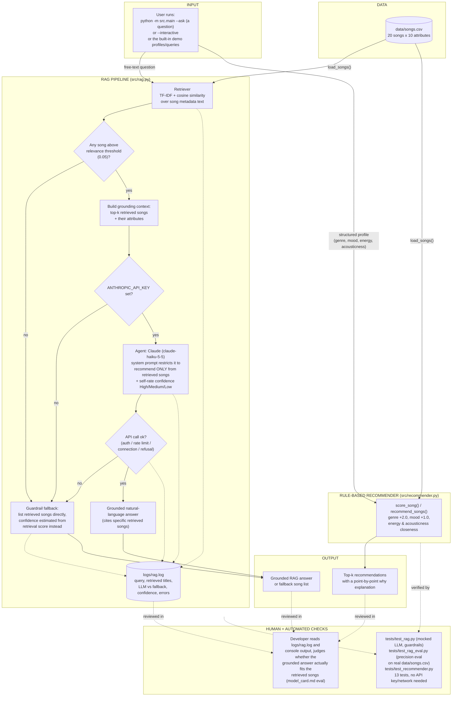

# VibeMatch — Rule-Based Recommender + Retrieval-Augmented Generation

## Original Project (Modules 1-3): Music Recommender Simulation

This repository started as the **Music Recommender Simulation** assignment,
shipped as **VibeMatch 1.0**. Its original goal was to build a small,
fully-explainable recommender: represent 20 songs and a listener's "taste
profile" (favorite genre, favorite mood, target energy, target acousticness)
as data, score every song against that profile with a transparent point
system, and return the top matches with a plain-English reason for each
point earned. The accompanying work evaluated where that scoring logic
produces good recommendations and where it quietly breaks — for example,
treating a mood like `sad` as a complete non-match just because the catalog
only has `sorrowful` and `melancholy`.

This README now covers that original system **and** the Retrieval-Augmented
Generation (RAG) feature added on top of it.

---

## Title and Summary

**VibeMatch** is a command-line music recommender with two cooperating
recommendation paths:

1. A **deterministic, rule-based scorer** (the original project) that takes
   a structured taste profile and returns ranked, fully-explained matches.
2. A **RAG pipeline** that takes a free-text question ("something chill and
   acoustic for late-night studying"), retrieves the catalog songs actually
   relevant to it, and asks an LLM to answer using *only* those retrieved
   songs.

Why it matters: most "AI recommender" demos either hardcode a scoring
formula or let an LLM free-associate about music it was never shown. This
project keeps both failure modes visible side by side — the rule-based path
shows exactly how a simple scoring formula can be confidently wrong, and the
RAG path shows how retrieval + grounding constrains an LLM to the data it
was actually given, with guardrails for when that data (or the API) isn't
available. That combination — transparent baseline, grounded generation,
and honest failure modes — is the same shape as production recommendation
and search systems, just small enough to read end to end in one sitting.

---

## Architecture Overview

Full system diagram: [`diagrams/rag_system.mmd`](diagrams/rag_system.mmd)
(Mermaid source — view it in any Mermaid-aware Markdown renderer, e.g.
GitHub). A rendered image of the same diagram (generated from that source
with `@mermaid-js/mermaid-cli`, not hand-drawn) is in
[`assets/architecture.png`](assets/architecture.png), for viewers that don't
render Mermaid.



**Reading the diagram:** a request enters through `src/main.py` and takes one
of two paths. A structured profile goes straight to the rule-based scorer in
`src/recommender.py`. A free-text question goes into the RAG pipeline in
`src/rag.py`: the **retriever** ranks all 20 songs by TF-IDF similarity to
the question and drops anything below a relevance threshold; if nothing
clears that bar, or `ANTHROPIC_API_KEY` isn't set, or the Claude API call
itself fails (auth, rate limit, connection, or a safety refusal), the
pipeline falls back to listing the retrieved songs directly instead of
guessing. Otherwise, the retrieved songs become the **only** context given to
the **agent** (Claude), which is instructed to recommend solely from that
list and to self-rate its confidence (High/Medium/Low) in the recommendation;
the fallback path estimates that same confidence from the retrieval score
instead, so every answer carries a confidence rating regardless of which
path produced it. Every step — including the confidence rating — is logged
to `logs/rag.log`, and both paths are covered by an automated pytest suite
(including a precision check against the real catalog) plus manual review of
the logs and console output.

---

## Setup Instructions

1. **Clone and enter the project**, then create a virtual environment
   (optional but recommended):

   ```bash
   python -m venv .venv
   source .venv/bin/activate      # Mac or Linux
   .venv\Scripts\activate         # Windows
   ```

2. **Install dependencies:**

   ```bash
   pip install -r requirements.txt
   ```

3. **(Optional, enables LLM-generated RAG answers)** set your Anthropic API
   key:

   ```bash
   export ANTHROPIC_API_KEY=sk-ant-...     # Mac or Linux
   set ANTHROPIC_API_KEY=sk-ant-...        # Windows (cmd)
   $env:ANTHROPIC_API_KEY="sk-ant-..."     # Windows (PowerShell)
   ```

   Get a key at [console.anthropic.com](https://console.anthropic.com).
   **Without a key, the app still runs** — the retriever and guardrails still
   execute, and `--ask`/`--interactive` fall back to showing the retrieved
   songs directly instead of an LLM-written explanation (see Execution
   Evidence below).

4. **Run the app:**

   ```bash
   # Default: rule-based profile demo + a couple of built-in RAG example queries
   python -m src.main

   # Ask a one-off natural-language question
   python -m src.main --ask "I want something upbeat for a workout"

   # Interactive RAG question loop
   python -m src.main --interactive
   ```

5. **Run the tests:**

   ```bash
   pytest
   ```

   The suite (`tests/test_recommender.py`, `tests/test_rag.py`,
   `tests/test_rag_eval.py` — 13 tests) runs fully offline: all Anthropic API
   calls are mocked, so no API key or network access is required. One file,
   `test_rag_eval.py`, runs the retriever against the real `data/songs.csv`
   catalog (not a mock) as a precision/reliability check — see Testing
   Summary below.

---

## Execution Evidence

Everything below is real, captured terminal output from the commands shown
— nothing is simulated or hand-written. It's organized into the four things
that matter for judging whether this actually works: a full end-to-end run,
the RAG/agent behavior specifically, the reliability/guardrail/evaluation
behavior, and clearly labeled output for every case. The excerpts below are
condensed for readability; [`execution_evidence.md`](execution_evidence.md)
holds the complete, unedited transcripts (the full 7-profile run, the full
mocked-agent demonstration, and the full `pytest -v` output) as a standalone
reproducible artifact.

### 1. End-to-end system run (3 inputs)

**Input 1 — structured profile → rule-based scorer:**

```bash
python -m src.main
```

```
================================================================
Profile: Chill Lofi
  (genre=lofi, mood=chill, energy=0.4, acousticness=0.75)
================================================================
1. Midnight Coding by LoRoom
   Score: 4.94
   Why:
     - genre match (+2.0)
     - mood match (+1.0)
     - energy close to target (+0.98)
     - acousticness close to target (+0.96)

2. Library Rain by Paper Lanterns
   Score: 4.84
   Why:
     - genre match (+2.0)
     - mood match (+1.0)
     - energy close to target (+0.95)
     - acousticness close to target (+0.89)
```

**Input 2 — free-text RAG query, no API key configured:**

```bash
python -m src.main --ask "I need something chill and acoustic for late-night studying"
```

```
================================================================
Ask VibeMatch: I need something chill and acoustic for late-night studying
================================================================
Retrieved from catalog:
  - Midnight Coding by LoRoom (lofi, chill, relevance 0.46)
  - Library Rain by Paper Lanterns (lofi, chill, relevance 0.39)
  - Spacewalk Thoughts by Orbit Bloom (ambient, chill, relevance 0.38)
  - Focus Flow by LoRoom (lofi, focused, relevance 0.10)
  - Dust Road Hymn by Willow & Pine (country, nostalgic, relevance 0.10)

Answer (fallback, no LLM used, confidence: High):
(LLM unavailable: ANTHROPIC_API_KEY is not set. Showing retrieved catalog matches directly.)
- Midnight Coding by LoRoom (lofi, chill, relevance 0.46)
- Library Rain by Paper Lanterns (lofi, chill, relevance 0.39)
- Spacewalk Thoughts by Orbit Bloom (ambient, chill, relevance 0.38)
- Focus Flow by LoRoom (lofi, focused, relevance 0.10)
- Dust Road Hymn by Willow & Pine (country, nostalgic, relevance 0.10)
Confidence: High - based on retrieval relevance only (no LLM judgment was available for this answer).
```

This is the no-API-key guardrail path, since this environment has no
`ANTHROPIC_API_KEY` configured. See **Section 2** below for what the
generation step itself (the "agent" half of RAG) actually does with that
same retrieved context.

**Input 3 — free-text RAG query with no good match (guardrail):**

```bash
python -m src.main --ask "underwater polka about tax law"
```

```
================================================================
Ask VibeMatch: underwater polka about tax law
================================================================
Retrieved from catalog: (nothing relevant found)

Answer (fallback, no LLM used, confidence: None):
No songs in the catalog are a good match for that request (no catalog songs were relevant enough). Try a different genre, mood, or feeling.
Confidence: None - no retrieved song cleared the relevance threshold.
```

Nothing in the 20-song catalog clears the relevance threshold, so the
pipeline reports that honestly instead of spending an API call asking Claude
to recommend something anyway.

### 2. AI feature behavior (RAG retrieval + grounded agent)

Inputs 2 and 3 above are genuine, real executions of the **retrieval** half
of RAG (`retrieve()` in `src/rag.py` actually ran TF-IDF/cosine similarity
over the real 20-song catalog). But this environment has no
`ANTHROPIC_API_KEY`, so neither one reached the **agent** (generation) half
— they hit the no-key guardrail instead.

To show the agent half too, the snippet below calls the exact same
production pipeline (`answer_query` → `generate_grounded_answer` →
`format_rag_result`, unmodified) with only the network call to Anthropic
replaced by a stub returning a fixed completion — the same technique used in
`tests/test_rag.py::test_answer_query_uses_llm_response_and_parses_its_stated_confidence`,
which this is the manual, narrated version of. Retrieval, grounding-context
construction, the system prompt, confidence-line parsing, and output
formatting are all real production code executing normally; only the
"Claude wrote this" step is substituted so the demo doesn't require a paid
API key:

```bash
python -c "
from unittest.mock import patch, Mock
from src.rag import answer_query
from src.recommender import load_songs
from src.main import format_rag_result
import os

os.environ['ANTHROPIC_API_KEY'] = 'mocked-for-demo'
songs = load_songs('data/songs.csv')

fake_text = (
    'Midnight Coding by LoRoom is the best fit here: it is lofi/chill with high '
    'acousticness (0.71), matching a quiet late-night study session.\n'
    'Confidence: High - genre, mood, and acousticness all line up with the request.'
)
text_block = Mock(type='text', text=fake_text)
fake_response = Mock(stop_reason='end_turn', content=[text_block])
mock_client = Mock()
mock_client.messages.create.return_value = fake_response

with patch('anthropic.Anthropic', return_value=mock_client):
    result = answer_query('I need something chill and acoustic for late-night studying', songs)

print(format_rag_result(result))
print('--- arguments actually sent to the (mocked) Anthropic client ---')
_, kwargs = mock_client.messages.create.call_args
print('model:', kwargs['model'])
print('user content sent to Claude:')
print(kwargs['messages'][0]['content'])
"
```

Real captured output:

```
================================================================
Ask VibeMatch: I need something chill and acoustic for late-night studying
================================================================
Retrieved from catalog:
  - Midnight Coding by LoRoom (lofi, chill, relevance 0.46)
  - Library Rain by Paper Lanterns (lofi, chill, relevance 0.39)
  - Spacewalk Thoughts by Orbit Bloom (ambient, chill, relevance 0.38)
  - Focus Flow by LoRoom (lofi, focused, relevance 0.10)
  - Dust Road Hymn by Willow & Pine (country, nostalgic, relevance 0.10)

Answer (LLM-generated, confidence: High):
Midnight Coding by LoRoom is the best fit here: it is lofi/chill with high acousticness (0.71), matching a quiet late-night study session.
Confidence: High - genre, mood, and acousticness all line up with the request.

--- arguments actually sent to the (mocked) Anthropic client ---
model: claude-haiku-5-5
user content sent to Claude:
Listener's request: I need something chill and acoustic for late-night studying

Candidate songs:
1. Midnight Coding by LoRoom. Genre: lofi. Mood: chill. Energy 0.42 out of 1.0. Acousticness 0.71 out of 1.0. Valence 0.56. Danceability 0.62. Tempo 78 bpm. (relevance 0.46)
2. Library Rain by Paper Lanterns. Genre: lofi. Mood: chill. Energy 0.35 out of 1.0. Acousticness 0.86 out of 1.0. Valence 0.60. Danceability 0.58. Tempo 72 bpm. (relevance 0.39)
3. Spacewalk Thoughts by Orbit Bloom. Genre: ambient. Mood: chill. Energy 0.28 out of 1.0. Acousticness 0.92 out of 1.0. Valence 0.65. Danceability 0.41. Tempo 60 bpm. (relevance 0.38)
4. Focus Flow by LoRoom. Genre: lofi. Mood: focused. Energy 0.40 out of 1.0. Acousticness 0.78 out of 1.0. Valence 0.59. Danceability 0.60. Tempo 80 bpm. (relevance 0.10)
5. Dust Road Hymn by Willow & Pine. Genre: country. Mood: nostalgic. Energy 0.48 out of 1.0. Acousticness 0.81 out of 1.0. Valence 0.58. Danceability 0.55. Tempo 88 bpm. (relevance 0.10)
```

This is the direct evidence that it's genuinely RAG, not "retrieve and
separately ask an LLM something unrelated": the "user content sent to
Claude" block above shows the model receives *only* the 5 retrieved songs
with their real attribute values, nothing else about the catalog — and the
answer names one of exactly those songs and cites its real acousticness
value (0.71). With a real `ANTHROPIC_API_KEY`, the only thing that changes
is who writes that `fake_text` string — Claude instead of this script — the
surrounding pipeline is identical.

### 3. Reliability / guardrail / evaluation behavior

Real, captured `pytest -v` output (13 tests, 0 failures, no API key or
network access used):

```
tests/test_rag.py::test_retrieve_ranks_relevant_songs_above_irrelevant_ones PASSED [  7%]
tests/test_rag.py::test_retrieve_returns_nothing_for_unrelated_query PASSED [ 15%]
tests/test_rag.py::test_retrieve_respects_k PASSED                       [ 23%]
tests/test_rag.py::test_answer_query_with_no_relevant_songs_skips_llm_call PASSED [ 30%]
tests/test_rag.py::test_answer_query_falls_back_when_no_api_key PASSED   [ 38%]
tests/test_rag.py::test_answer_query_uses_llm_response_and_parses_its_stated_confidence PASSED [ 46%]
tests/test_rag.py::test_answer_query_estimates_confidence_when_model_omits_confidence_line PASSED [ 53%]
tests/test_rag.py::test_answer_query_falls_back_on_authentication_error PASSED [ 61%]
tests/test_rag_eval.py::test_retrieval_precision_against_real_catalog PASSED [ 69%]
tests/test_rag_eval.py::test_retrieval_abstains_on_unanswerable_queries PASSED [ 76%]
tests/test_rag_eval.py::test_retrieval_top_result_is_always_the_highest_score PASSED [ 84%]
tests/test_recommender.py::test_recommend_returns_songs_sorted_by_score PASSED [ 92%]
tests/test_recommender.py::test_explain_recommendation_returns_non_empty_string PASSED [100%]

============================= 13 passed in 3.10s ==============================
```

What each guardrail/evaluation test actually proves:

- `test_answer_query_with_no_relevant_songs_skips_llm_call` — a nonsense
  query never reaches the Anthropic client at all (asserted with a mock
  spy), matching Input 3 above.
- `test_answer_query_falls_back_when_no_api_key` /
  `test_answer_query_falls_back_on_authentication_error` — missing or
  rejected credentials degrade to the fallback instead of crashing,
  matching Input 2 above.
- `test_answer_query_uses_llm_response_and_parses_its_stated_confidence` /
  `test_answer_query_estimates_confidence_when_model_omits_confidence_line` —
  the confidence-parsing logic shown live in Section 2 is also asserted
  automatically, including the case where the model forgets to include a
  confidence line.
- `test_retrieval_precision_against_real_catalog` /
  `test_retrieval_abstains_on_unanswerable_queries` (in
  `tests/test_rag_eval.py`) — a **precision evaluation**, not just a unit
  test: it runs the retriever against the real `data/songs.csv` (no mock
  data) with queries whose genuinely relevant songs were identified by
  reading the catalog, and checks both that real matches surface and that
  unanswerable queries correctly return nothing. This is the test that
  caught a real stopword-leakage bug during development — see Testing
  Summary below.

`logs/rag.log` (not reproduced here since it accumulates across runs) is
the other reliability mechanism: every query, what was retrieved, which
path answered it, the resulting confidence, and the specific exception type
on any API failure are all written there, so a failure can be diagnosed
from the log instead of just a stack trace.

### 4. Clear, labeled output for every case

Every example above states, in its own heading or inline note, exactly what
it is: which input produced it, whether it went through the rule-based
scorer or the RAG pipeline, and whether the Anthropic call was live,
mocked, or never reached (guardrail). Nothing above is presented as "what
the system does" without saying which of those three it actually was.

---

## Design Decisions

- **Kept the rule-based scorer as a separate, deterministic path instead of
  replacing it with RAG.** It's fully explainable (every point is traceable
  to one rule) and costs nothing to run, which makes it a useful baseline to
  compare the LLM-based path against. Trade-off: it can't handle a request
  outside its four fields (genre, mood, energy, acousticness), which is
  exactly the gap RAG fills.
- **TF-IDF + cosine similarity, implemented from scratch, instead of
  embeddings or a vector database.** The catalog is 20 songs — a from-scratch
  index is easy to read end to end, has zero extra dependencies, and is fast
  enough to rebuild on every query. Trade-off: it's pure keyword matching, so
  it can only recognize synonyms that are spelled out in the indexed text
  (see the next point); it would not scale as-is to a catalog of thousands
  of songs with richer, more varied language.
- **Retrieval is indexed on bucketed feature descriptions, not song titles.**
  The first version indexed each song's full description, including title
  and artist. A query like *"...late-night studying"* then ranked **Night
  Drive Loop** above the actual chill/acoustic songs, purely because its
  title shares the word "night" with the query. Fixed by indexing a separate
  text built only from genre, mood, and energy/acousticness/valence/
  danceability/tempo turned into descriptive words (e.g. "acoustic
  unplugged", "low energy calm") — title/artist are kept for display and for
  the LLM to cite, but excluded from the similarity index. This is the kind
  of bug that only shows up by actually running realistic queries, not from
  unit tests on a small hand-built catalog (see Testing Summary).
- **A relevance threshold that can return zero results.** An earlier design
  always returned the top-k songs regardless of score. That meant a
  completely unrelated query (e.g. "underwater polka about tax law") still
  got a confident-looking recommendation. Dropping low-scoring songs below a
  threshold means the system can say "nothing fits" — a worse-looking
  output, but a more honest one.
- **Strict grounding in the system prompt, not just "pass the context along."**
  The Claude system prompt explicitly forbids recommending or implying any
  song not in the retrieved list. Without that constraint, an LLM asked
  "what's a good chill acoustic song" will happily answer from its own
  training knowledge, which defeats the point of retrieval — the response
  would no longer be verifiable against the actual catalog.
- **Haiku 5.5 as the default model, overridable via `VIBEMATCH_MODEL`.** This
  is a small grounded-QA task over at most 5 short song descriptions — not a
  task that benefits from a larger, more expensive model, and a toy project
  gets run (and re-run while developing) often enough that cost adds up.
- **Every answer carries a confidence rating, computed differently depending
  on the path.** When Claude answers, its system prompt requires it to end
  with a self-rated `Confidence: High/Medium/Low` line, which the code
  parses out. When there's no live model call (no key, an API error, no
  relevant songs), confidence is instead estimated from the retrieval
  similarity score. Either way, the result always has a confidence field —
  it's a plain, inspectable signal of how much to trust the answer, not a
  guarantee (see model_card.md for its limits).
- **Fail open to a deterministic fallback, never fail closed.** Missing API
  key, auth errors, rate limits, connection errors, and model refusals are
  all caught separately and all route to the same fallback: show the
  retrieved songs plainly. The app never crashes because of the LLM call,
  and it never silently returns nothing.

---

## Testing Summary

**What worked:** `pytest` (13 tests across `tests/test_recommender.py`,
`tests/test_rag.py`, `tests/test_rag_eval.py`) runs fully offline by mocking
the Anthropic client with `pytest-mock`, so the suite verifies retriever
ranking, the "nothing relevant" guardrail, the missing-API-key fallback, a
successful mocked LLM response with its confidence line parsed correctly,
and an authentication-error fallback — without needing a real key, network
access, or spending any API budget in CI. `test_rag_eval.py` adds a
precision/reliability check that runs the retriever against the **real**
`data/songs.csv` catalog (not a mock) with queries whose genuinely relevant
songs I identified by reading the data, plus queries nothing in the catalog
should answer.

**What didn't work at first:** two separate retrieval-quality bugs, both
missed by the small mocked-fixture tests and only caught by running against
real data:

1. Song titles leaking into the similarity index let **Night Drive Loop**
   outrank genuinely chill/acoustic songs for a "late-night studying" query,
   purely because its title shares the word "night" with the query. Fixed by
   indexing bucketed feature descriptions separately from the title/artist
   text shown to the LLM (see Design Decisions).
2. `test_rag_eval.py`'s check that nonsense queries return *no* results
   failed: a query containing the word "not" retrieved a real song at 0.30
   relevance, because one bucket phrase ("not very danceable") put the
   stopword "not" in the index, and out-of-vocabulary query words are
   silently zero-weighted rather than penalized — so that one incidental
   match dominated the score. Fixed by stripping common English stopwords
   from both the index and incoming queries.

**What this taught me about testing an LLM-touching system:** unit tests
with a mocked LLM and a small fixture are good at proving the *guardrails*
work (no key, bad key, no relevant results, confidence parsing) — but a
small, hand-picked fixture can accidentally avoid real failure modes. Both
bugs above only surfaced once there was a test (or a manual run) exercising
the retriever against the actual 20-song catalog with realistic and
adversarial queries, the same way the original rule-based project's
"adversarial profile" testing caught scoring bugs the two starter unit tests
didn't.

---

## Reflection

Building the retrieval step by hand (no embedding API, no vector database)
made something concrete that's easy to miss when RAG is a one-line library
call: the generation step can only ever be as good as what was retrieved.
A perfectly-behaved, well-grounded LLM still produces a useless answer if
the retriever handed it the wrong songs — and that failure mode is silent
unless you actually read what was retrieved, which is why the guardrails
log and surface the retrieved list rather than hiding it behind the final
answer. It's the same lesson the original rule-based project taught at a
smaller scale (a scoring rule is only as fair as the labels and weights
behind it) — layering an LLM on top doesn't remove that problem, it just
moves it one step earlier, into the retrieval step.

The graded responsible-AI reflection — how this was built in collaboration
with an AI agent, one of its suggestions I accepted versus one I rejected or
revised, and this system's limitations — is in [`model_card.md`](model_card.md),
not here.
